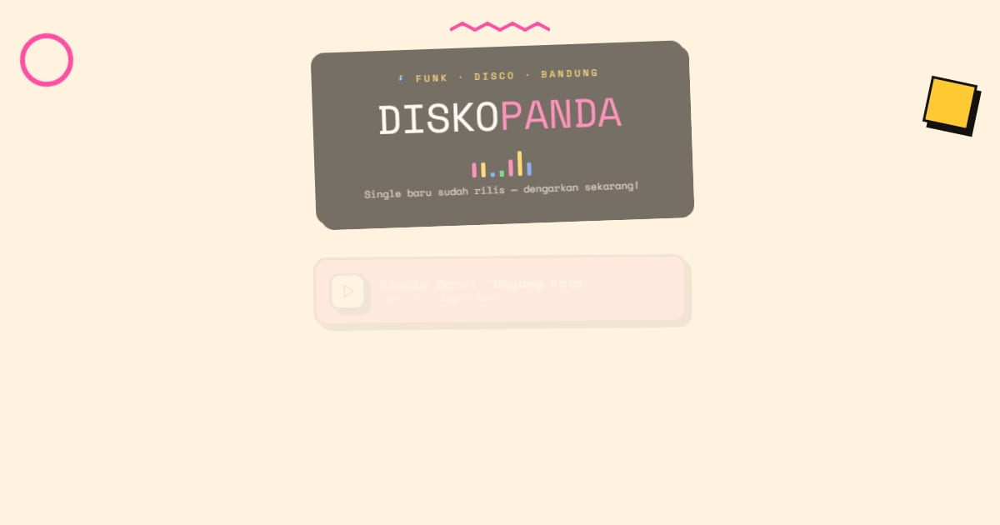

# Disko Panda — Band Funk-Disko dari Bandung

Tautan Disko Panda, band funk-disko dari Bandung: tur "Panas Dingin" enam kota Oktober–Desember 2026, beli tiket, merch resmi, vinyl 7", dan booking manggung.

**Demo live:** https://linkinbio-disko.vercel.app



> Template link-in-bio dengan persona fiktif. Akun, klien, harga, dan jadwal hanya contoh; tautan utama menuju halaman dalam yang benar-benar ada, dan formulir tidak mengirim data.

## Konsep

Persona Disko Panda, band funk. Poster gig bergaya Memphis: kartu berbingkai tebal dengan bayangan keras dan equalizer beranimasi.

## Halaman

- `/` — poster Memphis: kepala band dengan equalizer bergerak, kartu tautan berwarna berbayang keras, bentuk-bentuk bergoyang
- `/jadwal` — tur enam kota dengan sisa tiket, pemilih tiket & total, formulir booking
- `/merch` — kaos dengan stok per ukuran, vinyl, totebag, stiker; tas belanja dengan pilihan ambil di konser

## Teknologi

- Next.js 15.5 (App Router) dan React 19
- Tailwind CSS v4
- JavaScript
- Framer Motion, Lucide (ikon)
- Font: Bungee, Space Mono (next/font)
- SEO: metadata per halaman, Open Graph, JSON-LD, sitemap.xml, dan robots.txt

## Menjalankan secara lokal

```bash
npm install
npm run dev
```

Buka http://localhost:3000. Untuk build produksi: `npm run build` lalu `npm start`.

---

Bagian dari koleksi 12 template link-in-bio di [PortalBio](https://portal-bio-neon.vercel.app). Dibuat oleh [PintuWeb](https://pintuweb.com), jasa pembuatan website.
